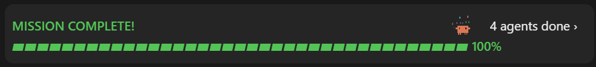

# Claude Crew

**See what Claude is doing while it works.** A [Claude Code](https://claude.com/claude-code) mod that puts a mission bar above your prompt while Claude works through a plan, and a pixel-art crew in a sidebar, one Claude in a silly hat for every subagent it sends out.





## What you get

**The mission band**, right above the prompt:

- The step Claude is on and a `▰▰▰▰▰▱▱▱` bar with the plan's progress.
- A tiny pixel Claude typing away at his laptop while the work runs, who jumps in confetti when the mission is complete.
- A count of the subagents at work. Click **N agents working ›** to open the crew.

**The crew sidebar:**

- Every subagent as a pixel Claude with its own outfit and a name to match: Sir Pixel in a top hat, Wizard Pebble, Sheriff Ziggy, King Mochi, Professor Biscuit with a spinning propeller cap, Captain Noodle in a pirate bandana, and more (12 hats, plus sunglasses, mustaches and rosy cheeks).
- Each one's task, its own progress bar and what it's doing right now (`Reading main.ts`, `Searching "refresh"`, `Running npm test`…).
- They type while they work, celebrate when they finish, and go grey and dizzy if they fail.
- The plan's steps, ticked off as Claude goes.

The band only shows up when there's a plan or a crew, so it stays out of your way the rest of the time.

## Install

At the prompt of a Claude Code terminal session:

```
/plugin install mission-crew --marketplace Smartulf123/mission-crew
```

Answer `y` to add the marketplace, then pick a scope (user scope loads it in every session).

From a shell:

```bash
claude plugin install mission-crew --marketplace Smartulf123/mission-crew
```

In the Claude desktop app, where `/plugin` does not run: click **+** next to the prompt box, then **Plugins**, **Add marketplace** with `Smartulf123/mission-crew`, then **Add plugin**.

## Commands

| Command | What it does |
| --- | --- |
| `/crew` | Opens the crew sidebar |
| `/crew demo` | Plays a short made-up mission, so you can see everything at once |
| `/crew hide` | Hides the band (`/crew` brings it back) |
| `/crew clear` | Forgets the current plan and crew |

## How it works

Claude Crew is a hooks module for Claude Code's plugin API, with no setup and nothing to configure:

- **The plan** comes from Claude's own to-do tools: `TodoWrite`, `TaskCreate`/`TaskUpdate`, and the desktop app's task list.
- **The crew** comes from each subagent's spawn, every tool call it makes, and its end. Nobody can know in advance how long a subagent takes, so its bar creeps towards 92% as it works and fills when it's done.
- **The art** is drawn after the little Claude in Claude Code's welcome logo, as animated SVG (CSS and SMIL, no scripts). Each picture's markup only changes when a crew member's mode does, so nothing flickers as the numbers move.
- **Surfaces:** the animations draw in the desktop app. In a plain terminal you get a text version: the same band and sidebar with a `▰▱` bar and hat emoji.

The crew only watches. If anything in the mod fails, your tool calls and subagents carry on as if it weren't there.

## Developing

```bash
claude plugin validate .
```

```bash
claude plugin test .
```

`hooks/register.tsx` holds the hooks and the drawing, `hooks/art.ts` the pixel art (plain functions with no imports, so you can preview them in a browser), and `types/index.d.ts` the state the mod keeps.

## License

[MIT](LICENSE)
